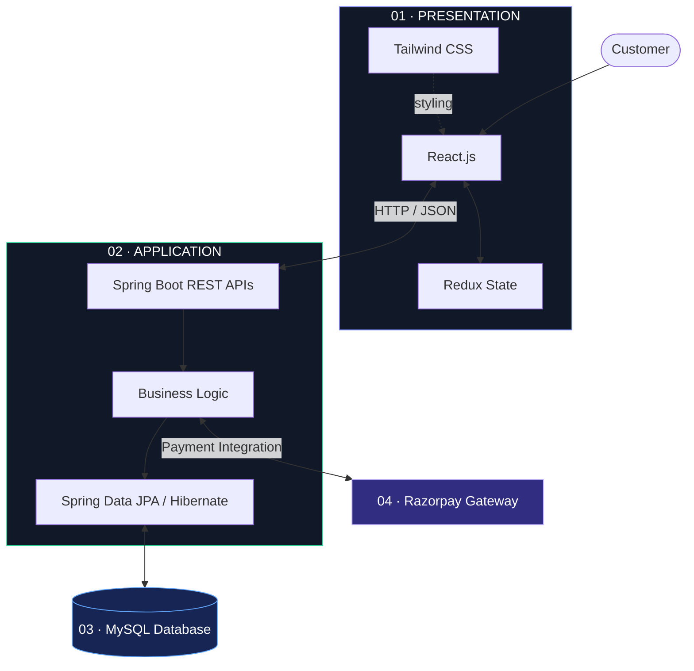

# 🛍️ E-Commerce Platform

<p align="center">
  
</p>

<p align="center">
  
  
  
  
  
  
</p>


<p align="center">
  
</p>

<p align="center">
  A full-stack commerce application bringing together <strong>interactive frontend experiences, backend business logic, relational persistence, and online payment integration.</strong>
</p>

<p align="center">
  <a href="#-overview">Explore</a> &nbsp; ✦ &nbsp;
  <a href="#-features">Features</a> &nbsp; ✦ &nbsp;
  <a href="#-architecture">Architecture</a> &nbsp; ✦ &nbsp;
  <a href="#-installation">Installation</a>
</p>

---

## ◈ 01 — Overview

**More than a storefront. An exploration of full-stack engineering.**

This project is a full-stack e-commerce platform built with React.js, Spring Boot, and MySQL. It brings together essential online shopping workflows, including product discovery, account management, cart operations, order processing, and Razorpay payment gateway integration.

The application connects a component-driven frontend to a Java backend through RESTful APIs, with Spring Data JPA and Hibernate supporting relational persistence.

Redux provides centralized client-side state management, while Tailwind CSS supports responsive interface development.

The goal is to explore how the individual layers of a modern web application work together to deliver a cohesive commerce experience.

<p align="center">
  
</p>

## ◈ 02 — Features

<table>
  <tr>
    <td width="50%" valign="top">
      <h3>◉ &nbsp; Authentication</h3>
      User registration, login, and profile management for account-based shopping.
      <br/><br/>
      <sub>USER MANAGEMENT</sub>
    </td>
    <td width="50%" valign="top">
      <h3>⌕ &nbsp; Product Discovery</h3>
      Product catalog browsing, category-based organization, search, and filtering.
      <br/><br/>
      <sub>CATALOG MANAGEMENT</sub>
    </td>
  </tr>
  <tr>
    <td width="50%" valign="top">
      <h3>▤ &nbsp; Shopping Cart</h3>
      Add, remove, and update items with Redux-powered client-side state management.
      <br/><br/>
      <sub>CART OPERATIONS</sub>
    </td>
    <td width="50%" valign="top">
      <h3>▣ &nbsp; Order Processing</h3>
      Order-related workflows with order and payment status handling.
      <br/><br/>
      <sub>ORDER MANAGEMENT</sub>
    </td>
  </tr>
  <tr>
    <td width="50%" valign="top">
      <h3>◇ &nbsp; Payment Integration</h3>
      Razorpay integration connecting the checkout experience with an external payment gateway.
      <br/><br/>
      <sub>PAYMENT WORKFLOWS</sub>
    </td>
    <td width="50%" valign="top">
      <h3>▧ &nbsp; Responsive UI</h3>
      Adaptive interfaces styled with Tailwind CSS for different screen sizes.
      <br/><br/>
      <sub>FRONTEND ENGINEERING</sub>
    </td>
  </tr>
</table>

<p align="center">
  
</p>

## ◈ 03 — Technology Stack

<p align="center">
  
</p>

<table>
  <tr>
    <th>Layer</th>
    <th>Technology</th>
    <th>Responsibility</th>
  </tr>
  <tr>
    <td><strong>Frontend</strong></td>
    <td>React.js</td>
    <td>Component-based user interfaces and interaction handling</td>
  </tr>
  <tr>
    <td><strong>State</strong></td>
    <td>Redux</td>
    <td>Shared client-side application state</td>
  </tr>
  <tr>
    <td><strong>Styling</strong></td>
    <td>Tailwind CSS</td>
    <td>Responsive, utility-first styling</td>
  </tr>
  <tr>
    <td><strong>Backend</strong></td>
    <td>Java, Spring Boot</td>
    <td>Application logic and REST API development</td>
  </tr>
  <tr>
    <td><strong>Persistence</strong></td>
    <td>Spring Data JPA, Hibernate</td>
    <td>ORM and database access</td>
  </tr>
  <tr>
    <td><strong>Database</strong></td>
    <td>MySQL</td>
    <td>Relational data storage</td>
  </tr>
  <tr>
    <td><strong>Payments</strong></td>
    <td>Razorpay</td>
    <td>External payment gateway integration</td>
  </tr>
</table>

<p align="center">
  
</p>

## ◈ 04 — System Architecture

<p align="center">
  <em>A layered architecture connecting presentation, application logic, persistence, and external payment services.</em>
</p>



### Request lifecycle

| Stage | Responsibility |
|:--:|---|
| `01` | The customer interacts with the React interface. |
| `02` | Redux manages shared frontend state where required. |
| `03` | HTTP requests connect the frontend to Spring Boot APIs. |
| `04` | Backend logic processes application operations. |
| `05` | JPA and Hibernate mediate relational database access. |
| `06` | Razorpay is integrated into the payment workflow. |

<p align="center">
  
</p>

## ◈ 05 — Getting Started

### Prerequisites

| Requirement | Purpose |
|---|---|
| [Node.js](https://nodejs.org/) | Frontend tooling and dependencies |
| [Java JDK](https://adoptium.net/) | Spring Boot runtime and development |
| [MySQL](https://www.mysql.com/) | Relational database |
| [Git](https://git-scm.com/) | Source control |
| [Razorpay](https://razorpay.com/) | Test credentials for payment integration |

### Step 01 — Clone

```bash
git clone <YOUR_REPOSITORY_URL>
cd <YOUR_PROJECT_DIRECTORY>
```

Replace the placeholders with your repository URL and project directory.

### Step 02 — Configure MySQL

Create a database for the application:

```sql
CREATE DATABASE ecommerce_db;
```

Configure the datasource in your Spring Boot application's `application.properties` or `application.yml` file.

Example:

```properties
spring.datasource.url=${DB_URL:jdbc:mysql://localhost:3306/ecommerce_db}
spring.datasource.username=${DB_USERNAME:root}
spring.datasource.password=${DB_PASSWORD}
```

Adapt these settings to the database configuration used by your project.

### Step 03 — Configure Razorpay

Provide payment credentials through environment variables or a secrets manager.

```env
RAZORPAY_KEY_ID=your_razorpay_key_id
RAZORPAY_KEY_SECRET=your_razorpay_key_secret
```

These are example variable names. Map them to the configuration expected by your backend.

> **Security:** Never commit real credentials or expose the Razorpay secret key in frontend code.

### Step 04 — Start the backend

For a Maven-based Spring Boot application, run the appropriate command from the backend directory.

**Linux / macOS**

```bash
./mvnw spring-boot:run
```

**Windows**

```powershell
.\mvnw.cmd spring-boot:run
```

Use the Gradle wrapper if the project uses Gradle.

### Step 05 — Start the frontend

From the frontend directory:

```bash
npm install
npm run dev
```

Use the development script defined in your actual `package.json` if it differs.

### Step 06 — Verify

Once both services are running, verify frontend-to-backend connectivity, catalog and cart workflows, database operations, and payment integration in the configured test environment.

Actual service URLs, ports, scripts, and environment variable names depend on your implementation.

<p align="center">
  
</p>

## ◈ 06 — Engineering Principles

- **Separation of concerns** — Distinct responsibilities for interface, backend logic, persistence, and integrations.
- **API-driven communication** — HTTP-based communication between the frontend and backend.
- **Relational persistence** — Database-backed application operations using JPA and Hibernate.
- **Centralized state management** — Shared frontend state managed with Redux.
- **External service integration** — Payment gateway connectivity through Razorpay.
- **Responsive design** — Adaptive layouts with Tailwind CSS.

### Security considerations

Payment and account workflows should validate sensitive operations on the backend.

- Validate incoming request payloads.
- Enforce authentication and authorization on protected endpoints.
- Keep API secrets out of source control.
- Verify payment results server-side before confirming an order as paid.
- Never trust client-submitted prices or payment statuses.
- Apply suitable database constraints and transaction boundaries.

These are recommended practices; the implementation of each control should be verified in the source code.

<p align="center">
  
</p>

## ◈ 07 — Roadmap

Potential improvements for future iterations:

- [ ] Automated unit and integration testing
- [ ] OpenAPI / Swagger API documentation
- [ ] Docker-based development environment
- [ ] CI/CD automation using GitHub Actions
- [ ] Structured logging and centralized exception handling
- [ ] Catalog pagination and query optimization
- [ ] Payment webhooks and idempotent order processing
- [ ] Production deployment and health monitoring

<p align="center">
  
</p>

## ◈ 08 — Contributing

Contributions, bug reports, and improvement suggestions are welcome.

1. Fork the repository.
2. Create a feature branch.
3. Implement and test your changes.
4. Commit with a descriptive message.
5. Submit a pull request describing the changes.

Please follow existing project conventions and never commit secrets or sensitive configuration.

## ◈ 09 — License

No license has been specified in this README. Add an appropriate `LICENSE` file and update this section before distributing the project under an open-source license.

---

<p align="center">
  
</p>

<p align="center">
  
</p>

<p align="center">
  <sub>FULL-STACK ENGINEERING &nbsp;·&nbsp; COMMERCE &nbsp;·&nbsp; INTEGRATION</sub>
</p>
